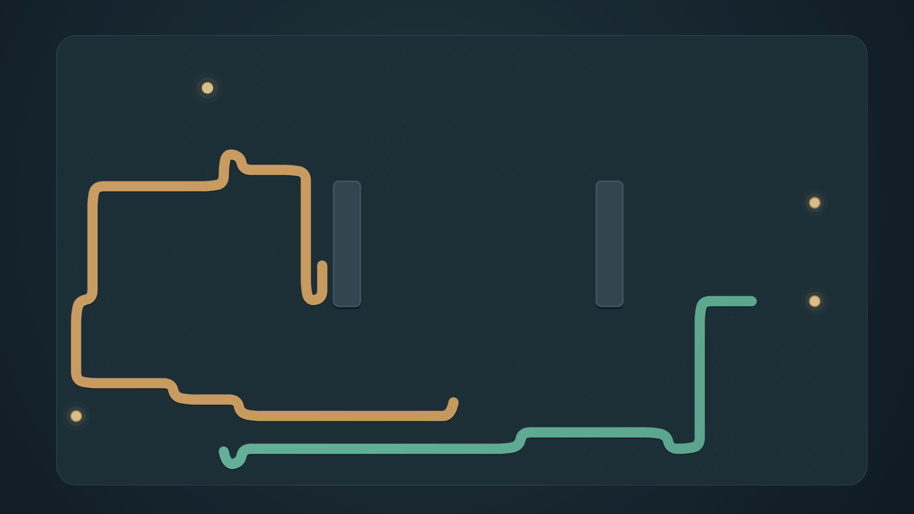

<p align="center">
  <a href="https://github.com/jeremykenedy/nibbles-hd#gh-light-mode-only"><picture><source media="(max-width: 600px) and (prefers-reduced-motion: reduce)" srcset="art/banner-mobile-still-light.c503585ceecd.svg"><source media="(prefers-reduced-motion: reduce)" srcset="art/banner-still-light.79750835c553.svg"><source media="(max-width: 600px)" srcset="art/banner-mobile-light.6db35af9989e.svg"></picture></a>
  <a href="https://github.com/jeremykenedy/nibbles-hd#gh-dark-mode-only"><picture><source media="(max-width: 600px) and (prefers-reduced-motion: reduce)" srcset="art/banner-mobile-still-dark.0892c8d55a67.svg"><source media="(prefers-reduced-motion: reduce)" srcset="art/banner-still-dark.a1bcb59c8043.svg"><source media="(max-width: 600px)" srcset="art/banner-mobile-dark.733ff37692cc.svg"></picture></a>
</p>

<p align="center">An original, offline TV screensaver where smooth matte snakes find food, grow and begin new rounds.</p>

<p align="center">
  <a href="https://github.com/jeremykenedy/nibbles-hd/releases"></a>
  <a href="https://github.com/jeremykenedy/nibbles-hd/releases/latest"></a>
  <a href="https://github.com/jeremykenedy/nibbles-hd/actions/workflows/ci.yml"></a>
  <a href="LICENSE"></a>
</p>
<p align="center">
  <a href="https://github.com/jeremykenedy"></a>
  <a href="https://github.com/jeremykenedy/nibbles-hd/stargazers"></a>
  <a href="https://github.com/sponsors/jeremykenedy"></a>
</p>

<p align="center"><a href="docs/screenshots.md"></a></p>

## Contents

- [Features](#features)
- [Requirements](#requirements)
- [Install](#install)
- [Fire TV Toolkit](#fire-tv-toolkit)
- [Device verification](#device-verification)
- [Documentation](#documentation)
- [License](#license)

## Features

| Feature | What you get | Guide |
| --- | --- | --- |
| Autonomous play | Food-seeking routes, real growth, collisions and fresh rounds | [Gameplay](docs/architecture.md) |
| Native motion | Smooth turns, matte ribbons and a gently moving board, with no scene text | [Screenshots](docs/screenshots.md) |
| Eight options | Speed, snake count, palette, stage, board scale, effects, lighting and randomization | [Configuration](docs/configuration.md) |
| Remote controls | D-pad settings, fullscreen preview and offline credits | [Controls](docs/configuration.md#remote-controls) |
| Offline runtime | No ads, analytics, tracking or network access | [Privacy](docs/privacy.md) |

## Requirements

Android 6.0/API 23 or later with DreamService support, a TV remote and permission to install APKs. A computer with Python 3.10+ and Android Platform Tools is needed for the standalone installer. Fire OS activation uses a compatible picker or Toolkit because its stock Settings may hide third-party dreams.

## Install

[Download the signed APK](https://github.com/jeremykenedy/nibbles-hd/releases/latest/download/nibbles-hd.apk), or use the guided installer:

```sh
git clone https://github.com/jeremykenedy/nibbles-hd.git
cd nibbles-hd
python3 install.py --serial YOUR_TV_IP:5555
```

Open **Nibbles HD** from your apps to adjust options and preview. Installation and updates preserve the current screensaver selection and system timers. Select Nibbles HD separately using a supported screensaver picker. See [installation and removal](docs/installation.md).

## Fire TV Toolkit

[Fire TV Toolkit](https://github.com/jeremykenedy/fire-tv-toolkit) offers guided installation, launcher choices, screensaver selection, supported timer controls and protection for supported settings. Set it up on your computer first:

```sh
git clone https://github.com/jeremykenedy/fire-tv-toolkit.git
cd fire-tv-toolkit
node setup.js
firetv-screensavers --install=nibbles-hd
screensaver --set=nibbles-hd
```

Run `firetv-screensavers --install=nibbles-hd` again to update. To remove it, select another saver first, then run `firetv-screensavers --uninstall=nibbles-hd --yes --force`. Removal deletes this app's local options. Toolkit and Fire TV UI open the app's native settings; they do not provide a generic editor for the eight options. [Integration details](docs/integrations.md).

## Device verification

| Target | Verified behavior | Limits |
| --- | --- | --- |
| Physical Amazon AFTDEC012E, Android 11/API 30, 1920x1080 | Native settings/Preview, moving gameplay, persistence, pause/recreation and ordinary five-minute idle Dream | One model; mixed pacing measurements, no thermal or reboot claim |
| Google TV emulator, Android 14/API 34, 1920x1080 | Native Preview, D-pad controls, alternate looks and lifecycle checks | Emulator Preview does not establish vendor idle behavior |
| Other Fire TV, Android TV and Google TV devices | Not tested | Volunteers needed; [report model, OS/API, resolution and results](https://github.com/jeremykenedy/nibbles-hd/issues/new?template=bug.yml) |

The renderer uses the actual native view size. Native 4K, every-device compatibility and universal 60 FPS are unverified. See [the measurements and their limits](docs/verification.md).

## Documentation

Start with the [documentation index](docs/index.md), [configuration](docs/configuration.md), [gallery](docs/screenshots.md) or [troubleshooting](docs/troubleshooting.md). Development and release checks are documented in [building](docs/building.md) and [releasing](docs/releasing.md).

Show some love by [starring this repository on GitHub](https://github.com/jeremykenedy/nibbles-hd).

## License

This project is open-sourced software licensed under the [Apache License 2.0](LICENSE). Required notices are in [NOTICE](NOTICE) and available offline in the app's Credits and licenses screen.
