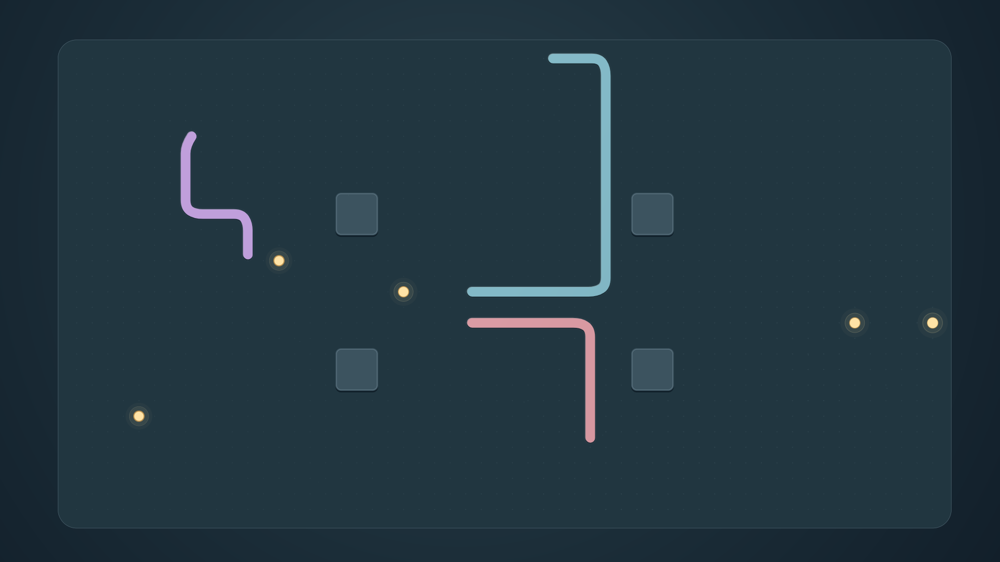

# Screenshots

These are actual 1920x1080 native physical Fire TV captures from the reviewed matte code 2 runtime. Production code 3 preserves its game/renderer/options/Preview/Dream source and compiled classes. The preview is a 384x216 resize of the default capture, with no scene retouching or added words. [Machine-readable provenance](../art/screenshots/provenance.json) records hashes, settings and source artifact.

<table><tr><td></td><td></td></tr></table>

Settings and credits captures from final code 3 are added after its bounded native packaging review. A pre-paint gray Settings capture and a round-fade frame were excluded from representative artwork, with raw originals retained in the private review record.
