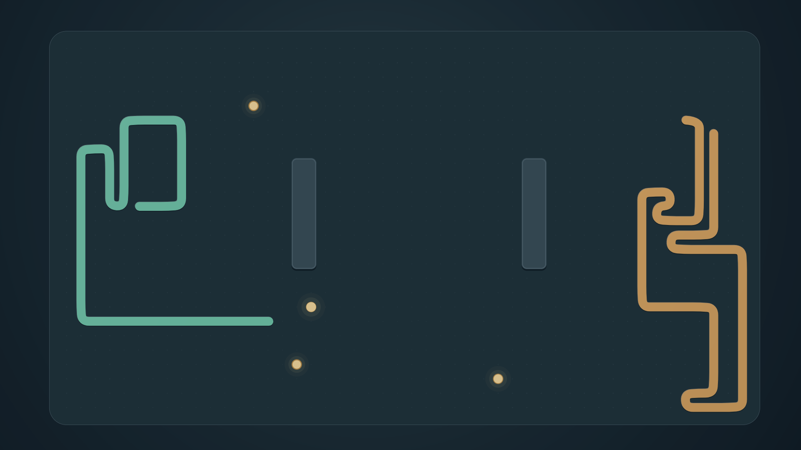
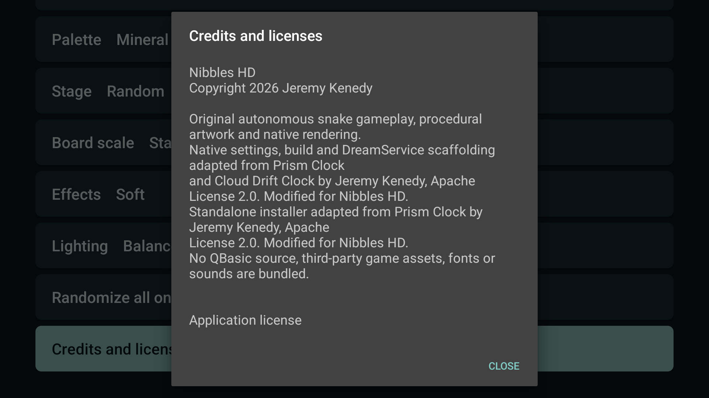
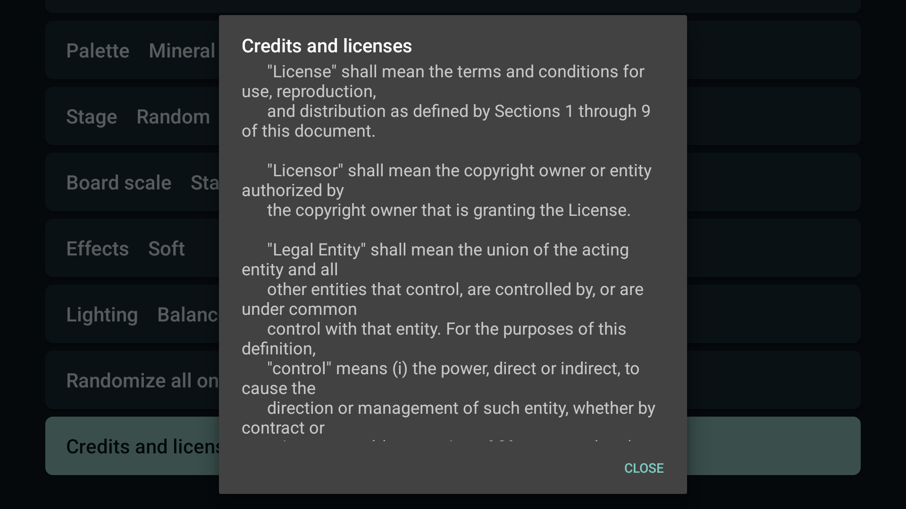

# Screenshots

The first two images are actual 1920x1080 physical Fire TV captures from reviewed matte code 2. Production code 3 preserves its game/renderer/options/provider/Preview/Dream source and compiled classes. The third scene image and the settings/credits images come from the exact final code 3 APK on the Google TV API 34 emulator. All are unmodified native PNGs. [Machine-readable provenance](../art/screenshots/provenance.json) records source artifacts, hashes and devices.

<table><tr>
<td></td>
<td></td>
<td></td>
</tr><tr>
<td></td>
<td></td>
<td></td>
</tr></table>

The APK's 384x216 preview is a plain JPEG resize of the physical default capture, with no scene retouching or added words. A pre-paint gray Settings capture and a round-fade frame were excluded from representative artwork, with raw originals retained privately. Physical code 2 moving review and code 3 emulator packaging checks are distinct; no new physical code 3 or 4K claim is implied.
